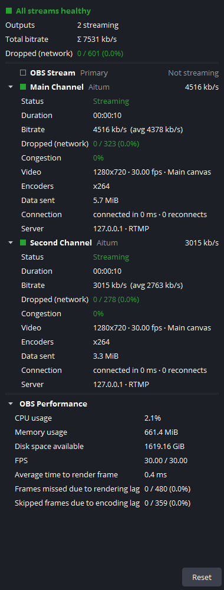
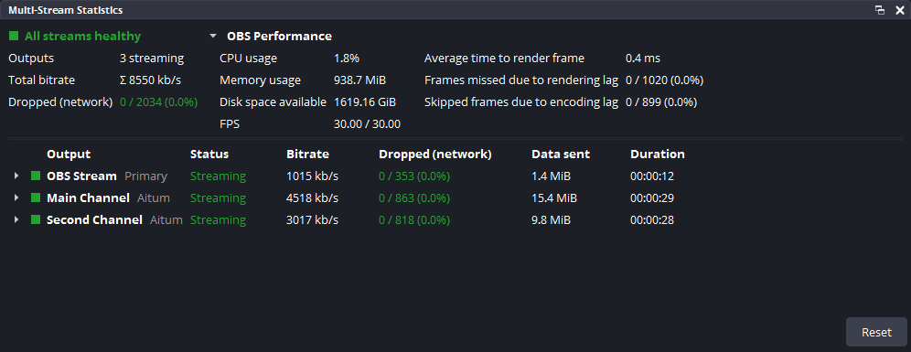

# Multi-Stream Stats

A native OBS Studio plugin that adds a **Multi-Stream Statistics** dock: live statistics for **every** streaming destination at once (OBS's own stream, each **Aitum Multistream** destination, and outputs of other multistream plugins), plus OBS's rendering, encoding and system performance.

OBS's built-in Stats dock only covers the primary stream. This dock also covers the destinations added by multistream plugins.

  
  &nbsp;
  

Screenshots from an isolated test copy of OBS Studio 33.0.1 with Aitum Multistream 1.0.9, streaming to a local loopback server (test destinations, real plugin output).

## Download

> **Release status:** no release has been published yet. Version 1.1.0 for **Windows** has passed its tests and is being prepared for release. **macOS and Linux** packages are planned: they are built and tested by the project's automated builds, and they will be offered only after those builds and tests pass. Until then, macOS and Linux are not supported. [COMPATIBILITY.md](COMPATIBILITY.md) shows what has been verified so far.

**[Download the latest release](../../releases/latest)**. You need **OBS Studio 33** or newer.

| Your computer | Download | Notes |
|---|---|---|
| **Windows 10/11** (64-bit) | `obs-multistream-stats-<version>-windows-x64-installer.exe` | Recommended. Works with a standard OBS installation and with portable OBS folders. |
| | `obs-multistream-stats-<version>-windows-x64-manual.zip` | Copy the files yourself ([how](INSTALL.md#windows-manual-zip)). |
| **macOS 13+** (Apple Silicon and Intel) | `obs-multistream-stats-<version>-macos-universal.dmg` | **Planned, in testing.** Open it and run the installer inside. One download for all Macs. |
| | `obs-multistream-stats-<version>-macos-universal-manual.zip` | **Planned, in testing.** The `.plugin` bundle to copy yourself ([how](INSTALL.md#macos-manual-zip)). |
| **Ubuntu 26.04** (x86_64) | `obs-multistream-stats_<version>_ubuntu-26.04_amd64.deb` | **Planned, in testing.** For OBS Studio 33 from the official OBS PPA. |
| **Other Linux** (x86_64) | `obs-multistream-stats-<version>-linux-x86_64-manual.tar.xz` | **Planned, in testing.** Per-user install; will not be tested outside Ubuntu ([details](COMPATIBILITY.md)). |
| OBS from **Flatpak** | – | Not supported yet ([why](COMPATIBILITY.md#flatpak)). |

Each release lists SHA-256 checksums in `SHA256SUMS.txt`. The packages are **not code-signed** yet: Windows SmartScreen and macOS Gatekeeper show a warning the first time. [INSTALL.md](INSTALL.md) explains what to click.

## Install

Close OBS Studio first.

- **Windows:** run the installer. It asks whether you use a **standard** OBS installation (installer or Steam) or a **portable** OBS folder, and finds your OBS if it can. Portable OBS installs need no administrator rights.
- **macOS** (once released): open the DMG, double-click **Install Multi-Stream Stats.pkg**. It installs for your user account.
- **Ubuntu 26.04** (once released): `sudo apt install ./obs-multistream-stats_<version>_ubuntu-26.04_amd64.deb`

Then start OBS and open **Docks → Multi-Stream Statistics**.

Manual installation, portable OBS, custom plugin folders, upgrading and uninstalling: **[INSTALL.md](INSTALL.md)**.

### Is it installed correctly?

- **Docks** menu: **Multi-Stream Statistics** is listed.
- **Tools → Plugin Manager** lists **Multi-Stream Statistics** (without a "Legacy" flag).
- **Help → Log Files → View Current Log** contains `[multistream-stats] loaded version …`.

Dock missing? See [Troubleshooting](INSTALL.md#troubleshooting).

## Features

### Which outputs are listed
- **OBS's own stream** is always listed, streaming or not ("Not streaming").
- **Every other output** (each Aitum Multistream destination, other plugins' outputs) is listed only while it is active: connecting, streaming, reconnecting or stopping. It appears when it starts and disappears when it stops or fails, independently of the others.
- When an output **fails on its own** (connection lost and reconnecting gave up, or it could not connect), it leaves the list, and the summary shows a **Last failure** line with the destination, the reason and how long ago (full error in the tooltip). The line disappears when the output starts again, or with **Clear Last Failure** (right-click menu).
- No platform names are built in; any Aitum destination works.

### Layout adapts to the dock
- **Tall docks** (e.g. a side column): everything is stacked: summary, one section per output, OBS Performance.
- **Wide docks** (e.g. below the preview): like OBS's native Stats dock: summary and OBS Performance side by side, and the outputs as a **table** with Status, Bitrate, Dropped (network), Data sent and, when there is room, Duration. Click a line for its details.
- The layout follows the dock as you resize it. Narrow docks (down to 260 px) never cut off measured values; captions shorten first, and the full text is in the tooltip.

### Per destination
Status (with stop reason and OBS's last error), duration, current and average **bitrate** (same formula as OBS's Stats dock), **network-dropped frames**, congestion, resolution and frame rate, encoders and their target bitrates, encoder lag (for encoders with their own video pipeline), data sent, connection time and reconnect count, ingest server host and protocol (the stream key is never read), stream delay.

### Summary and OBS Performance
Overall health, streaming/connecting/reconnecting/failed counts, **Σ total bitrate**, total network-dropped frames; CPU, memory, free disk space, FPS, average render time, frames missed due to rendering lag and frames skipped due to encoding lag (counted over the same period as OBS's native Stats dock).

### Accuracy
- No value is ever invented. Anything that cannot be measured shows **N/A**, and its tooltip says why. A genuine 0 is shown as 0.
- Rendering lag, encoding lag and network drops are kept separate; OBS-wide values are never attributed to individual destinations.
- Each output is counted exactly once.

### Native look, lightweight
Uses OBS's own theme classes, so the dock follows any OBS theme; scales with DPI and font size. A statistics tick takes about 30 µs and a dock refresh well under a millisecond on a typical PC.

## How it works

- Aitum Multistream creates a standard libobs output when a destination starts. The dock discovers outputs through the public `obs_enum_outputs` API and reads statistics with the same public `obs_output_*` APIs as OBS's own Stats dock.
- Aitum's documented obs-websocket vendor request `get_outputs` (read-only) tells the dock which destinations are configured, so each keeps its identity and order across restarts. It is optional: without obs-websocket, Aitum destinations are still shown while they are active.
- No memory scanning, no hooks, no private structures.

Details: [ARCHITECTURE.md](ARCHITECTURE.md).

## Known limitations

1. **Very fast starts:** libobs has no "output created" signal, so outputs are found by a 250 ms scan. If a connection succeeds before that scan, the start time is measured from detection (the tooltip says so). Outputs already live when OBS or the plugin started show their duration and average bitrate as N/A.
2. **Outputs shorter than 250 ms** (for example an instant connection failure) are not seen. Aitum's own dock still reports such errors.
3. **N/A by design:** SRT/RIST outputs report only bytes, and WHIP reports bytes and connect time; OBS itself reports no dropped frames or congestion for them.
4. **Multiple RTMP Outputs** (not tested live) names every output `multi-output`; rows are labelled by ingest host.
5. **Aitum Vertical** outputs are listed as generic outputs.
6. **Per-output encoder lag** is shown only for encoders with a dedicated video pipeline; outputs on the main pipeline share the OBS Performance value.
7. The dock's **Reset** and OBS's native "Reset stats" hotkey are independent (OBS offers no public event for the hotkey).
8. **English only** for now; other OBS languages fall back to English.
9. **OBS Studio 33.x.** Each build targets one OBS major version (on Linux the binary needs `libobs.so.33`). See [COMPATIBILITY.md](COMPATIBILITY.md).

## Reporting bugs

Please [open an issue](../../issues/new/choose) with your plugin and OBS versions, operating system, how you installed both, and your OBS log (**Help → Log Files → Upload Current Log File**). A screenshot of the dock helps; hovering an **N/A** value shows the reason.

## Building from source

See [BUILDING.md](BUILDING.md).

## License

GPL-2.0-or-later (see [LICENSE](LICENSE)). The plugin links libobs (GPL-2.0-or-later) and Qt 6 (LGPL-3.0, not redistributed) and includes `obs-websocket-api.h` (GPL-2.0-or-later). Details: [THIRD-PARTY-NOTICES.md](THIRD-PARTY-NOTICES.md).

This is an independent project. It is not affiliated with or endorsed by the OBS Project or Aitum. "OBS" and "OBS Studio" are names of the OBS Project.

This plugin was developed with AI assistance: most of its code and documentation were written with Claude Code, Anthropic's AI coding assistant. What was tested, and how, is listed in [COMPATIBILITY.md](COMPATIBILITY.md).
